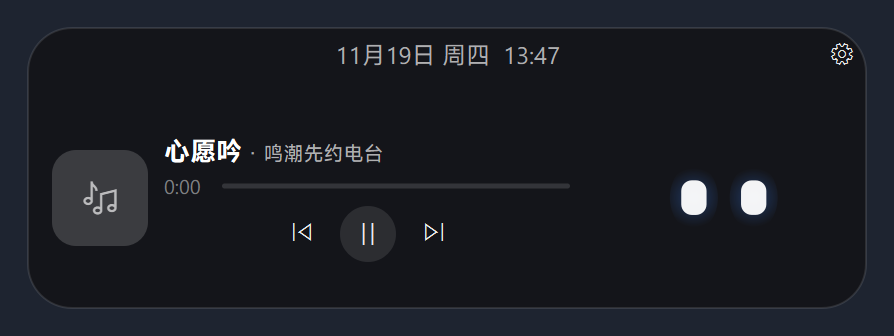
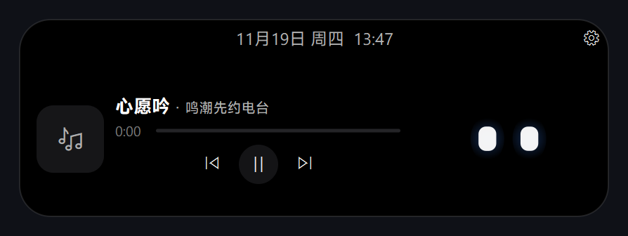
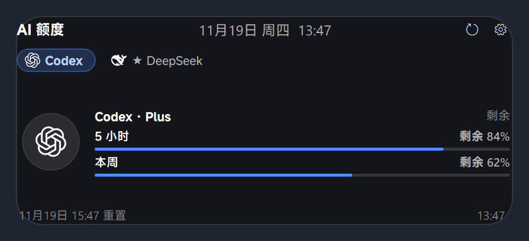
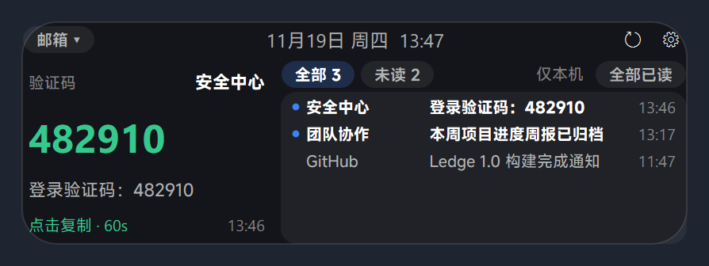
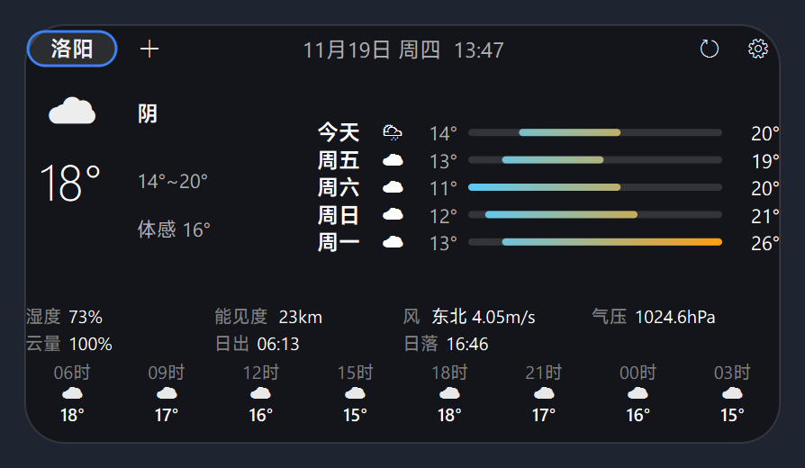
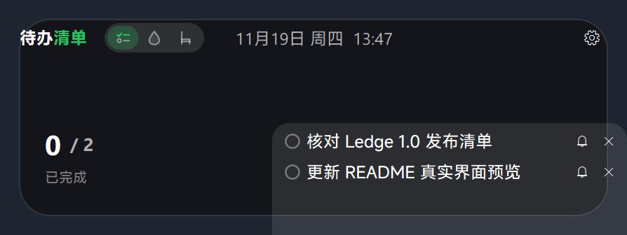
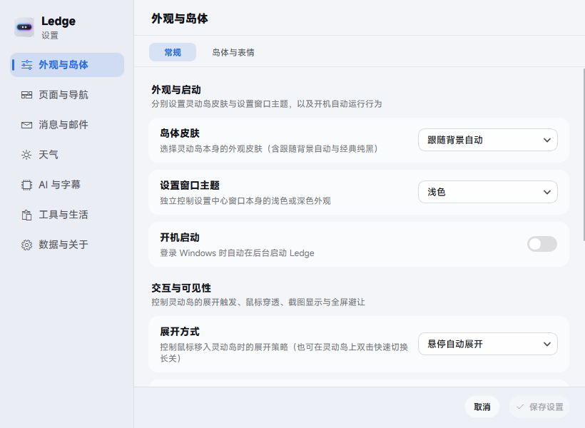

# Ledge · Windows 液态灵动岛

贴在屏幕边缘的液态毛玻璃灵动岛，支持邮件、AI 额度、天气、实时字幕、工具与生活提醒。Windows 10 / 11，Python + PySide6。

## 界面预览

### 收起态（时间天气 / 小形象）

<p align="center">
  &nbsp;&nbsp;
  
</p>

### 展开态核心页面

<p align="center">
  &nbsp;
  
</p>
<p align="center">
  &nbsp;
  
</p>
<p align="center">
  &nbsp;
  
</p>

### 设置中心（7 个一级分类，独立浅色 / 深色主题）

<p align="center">
  
</p>

## 快速开始

所有个人配置、本地历史与凭据均仅保存在本机，不上传至任何自有云端服务器。

### 方式 A：使用发布包（推荐）

1. 前往 GitHub **Releases** 下载 `Ledge-x.y.z.zip`（或便携包 `Ledge-portable.zip`）并解压到任意目录。
2. 确认解压目录中 `Ledge.exe` 与 `_internal` 文件夹位于同一目录。
3. 双击 **`Ledge.exe`** 即可启动。

### 方式 B：从源码运行

1. 安装 **Python 3.10 或更新版本**（安装时勾选 **Add python.exe to PATH**）。
2. 克隆仓库：
   ```powershell
   git clone https://github.com/Cantrarella/Ledge.git
   cd Ledge
   ```
3. 双击 **`setup.bat`** 自动创建 `.venv` 并安装依赖（连不上 PyPI 时自动回退国内镜像）。
4. 双击 **`Ledge.vbs`** 无控制台窗口启动。

开机启动可在系统托盘右键菜单或「设置 → 外观与岛体 → 常规」中一键开启。

## 功能

### 灵动岛
- 液态外形与表面张力连接，支持按住拖动、拉断液桥并吸附到屏幕上、下、左、右任意边缘。
- 弹性展开与收起动画，自适应帧率（交互/动画 60 FPS，空闲静止 30 FPS）。
- 收起态在时间天气与小形象之间轮换（默认每 30 秒，可配置）。
- 支持多显示器与高 DPI 缩放（100% / 125% / 150% / 200%）。
- 内置 5 套岛体皮肤：深色毛玻璃、浅色毛玻璃、晴空渐变、胭脂撞色、经典纯黑（`classic`）。

### 首页（419×140）
- 左侧紧凑媒体控制区：48×48 歌曲封面、单行自适应「标题 · 歌手」、横向进度条与起止时间、上一首 / 播放暂停 / 下一首控制。
- 右侧小形象区：双眼跟随鼠标移动，鼠标靠近时触发互动表情。

### 邮件（419×140 / 详情 419×236）
- 多账号 IMAP 监听（IDLE 实时推送，失败自动降级轮询）。
- 支持按账号筛选、全部 / 未读切换、本机已读状态管理及可选的服务器已读同步。
- 邮件详情仅以安全纯文本展示，支持本地正文缓存与内部滚动。
- 收到含验证码的邮件时，在左侧提供 180 秒大字验证码预览卡并支持一键复制。
- 不读取附件，不提供写信、回复或转发功能。

### AI 额度（419×176）
当前支持以下 5 个服务商的真实额度查询：
- **DeepSeek**：API Key 余额查询（总余额 / 充值 / 赠送与币种）。
- **WorkBuddy**：官网个人账号授权登录与积分 / 资源包额度查询。
- **Codex**：只读读取本机 Codex 登录凭证并查询 5 小时 / 本周周期额度。
- **Gemini**：网页会话（Google 邮箱 + 会话 Cookie）额度查询。
- **Grok Bot**：浏览器 PKCE 授权登录与周额度查询。

特性说明：
- 所有 API Key、Cookie 与 Token 均保存在 **Windows Credential Manager（Windows 凭据管理器）**，绝不写入 `config.json` 或日志。
- 仅展示真实查询结果，不生成假额度；未连接任何账号时自动隐藏额度页。
- 网络断开或限流时保留上一份有效快照并明确标记过期或错误状态。

### 天气（419×232）
- 多城市管理与快速切换，默认使用免费的 Open-Meteo 数据源（无需 Key），可选配置 OpenWeather。
- 顶部显示当前天气图标、温度、天气描述、温差范围与体感温度。
- 底部 4 列对齐展示湿度、能见度、风速风向、气压、云量、日出与日落时间。
- 内置未来 5 天温度条预报与可横向滚动的逐小时预报。
- 收起态提供整体居中的时间 + 天气组合显示。

### 实时字幕（419×185）
- 捕获系统声音或麦克风音频，进行本地日语语音识别并实时翻译为中文双语字幕。
- 收起态支持实时滚动显示最新双语字幕。
- 首次使用时自动下载离线识别模型（约 630 MB，支持断点续传）。

### 工具（419×140）
- **文件置物架**：支持拖放本地文件暂存、拖出或一键打开。
- **文字剪贴板历史**：自动记录近期文字剪贴板并支持一键回写，自动排除常见密码管理器等敏感来源。

### 生活（419×140）
- **待办清单**：轻量新增、勾选完成与重复提醒。
- **喝水记录**：每日杯数进度记录与定时喝水提醒。
- **久坐提醒**：支持间隔设置、提醒时段与午休免打扰，触发时在岛内弹出轻量提醒浮层。

### 通知
- 读取 Windows 系统通知，支持 QQ、微信与邮件提醒。
- 展开态岛旁提供 QQ / 微信未读快捷区，支持点击聚焦客户端与切回前台自动清除。
- 支持免打扰与任务栏闪烁兼容。

## 设置

设置中心采用独立窗口与独立浅色 / 深色主题（与岛体皮肤分离），修改草稿统一由底部「取消 / 保存设置」控制，左侧包含 7 个一级分类：

1. **外观与岛体**（常规 / 岛体与表情）
2. **页面与导航**
3. **消息与邮件**（通知 / 邮件账号）
4. **天气**
5. **AI 与字幕**（AI 额度 / 实时字幕）
6. **工具与生活**
7. **数据与关于**（数据维护 / 关于）

## 隐私与存储

- **本地配置**：保存于程序目录下的 `config.json`，本地运行数据与日志保存于 `data/`（日志路径为 `data/wisland.log`）。
- **敏感凭据**：邮箱授权码与 AI 额度 API Key / Cookie / Token 均通过 Windows 原生 API 加密存储于 **Windows Credential Manager**。
- **零遥测**：不包含任何使用统计、埋点或遥测上传。
- **最小网络访问**：外部网络请求仅用于你主动启用的天气查询、IMAP 邮件同步、AI 额度刷新、字幕翻译与首次模型下载。

## 服务与账号

以下外部服务均由用户按需自行配置：
- 邮件 IMAP 授权码（QQ 邮箱、163、Gmail、Outlook 等）
- 天气数据源（默认免 Key 的 Open-Meteo；可选 OpenWeather API Key）
- AI 额度账号（DeepSeek、WorkBuddy、Codex、Gemini、Grok Bot）
- 实时字幕中文翻译 API Key

## 已知限制

- 仅支持 **Windows 10 / 11**。
- 邮件模块仅用于只读提醒与正文预览，不处理附件。
- 不包含日程、日历、翻译词典或生词本功能。
- 第三方网页或服务端接口变更可能导致对应 AI 额度连接器暂时失效。
- 多显示器热插拔、高 DPI 混合缩放及长时间睡眠唤醒恢复仍在持续实机验证中。

## 开发与构建

- **源码运行**：
  ```powershell
  python run.pyw
  ```
- **运行测试**：
  ```powershell
  python -m pytest tests -q
  ```
- **构建便携版可执行文件**（需已安装 PyInstaller 与项目依赖）：
  ```powershell
  python -m PyInstaller --noconfirm Ledge.spec
  ```
  构建产物位于 `dist/Ledge/Ledge.exe`，配套打包脚本 [scripts/build.ps1](scripts/build.ps1) 会同步生成便携压缩包 `dist/Ledge-portable.zip`。

## 致谢与许可

- 本项目基于 [AsamiAkito/wisland](https://github.com/AsamiAkito/wisland) 的液态灵动岛窗口与动画架构演进重构，当前维护仓库位于 [Cantrarella/Ledge](https://github.com/Cantrarella/Ledge)。
- 使用 [MIT License](LICENSE) 开源许可。
